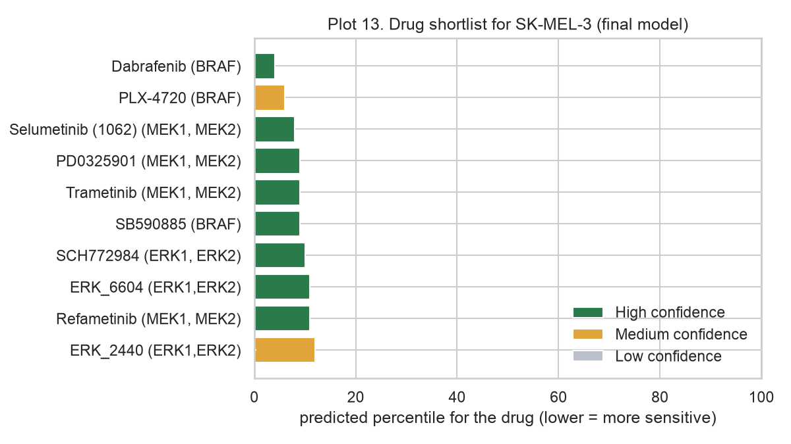
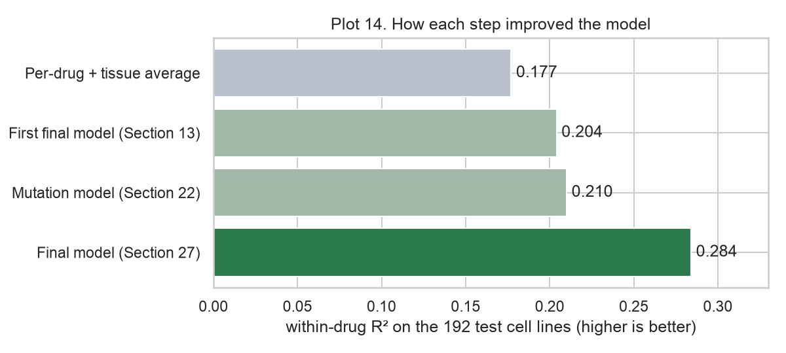

  

# Sentinel: Predicting Cancer Drug Response

**Which cancer drugs should a lab test first?**
AI + Health track · Veritas AI International High School Hackathon 2026

> **In plain words:** a lab enters a new cancer cell line's tissue and mutated genes, and Sentinel ranks 286 drugs so the most promising are tested first. On 192 cell lines the model never saw, **about half (52%) of its top-10 drugs were truly sensitive in the lab, against 1 in 5 (20%) picked at random.** It still misses about 6 in 10 sensitive results, so it helps decide what to test first, not what to skip.

**Try the app online:** [sentinel-rb92.onrender.com](https://sentinel-rb92.onrender.com) (the free server sleeps when idle, so the first load can take about a minute).

**Write-up:** [Google Doc](https://docs.google.com/document/d/1fMe7WM7WkJC7qbo7Z4hwHfJjHqzGYqJp_4EZj1_s7x0/edit?usp=sharing)

**Demo video (2 min):** [YouTube](https://youtu.be/8nT2pGRYafc)

*This project is a prototype and is not medical advice. All data comes from cancer cell lines grown in a laboratory, not from patients.*

## What it does
Sentinel helps a cancer researcher decide which drugs to test first on a new cell line. The researcher enters the cell line's tissue and which of 84 common cancer genes are mutated, and Sentinel ranks 286 drugs (295 drug IDs). For each drug it shows whether the cell line is predicted to be sensitive, whether the drug is expected to work at the doses that were tested, how reliably that drug was predicted in testing, and which genes move the prediction. For cell lines with RNA-seq data it also uses gene expression; for a new cell line without it, the app uses that tissue's average and says so. It warns when a profile is unusual for the model, for example a rare tissue or many more mutations than real cell lines have. A researcher can also paste a list of mutated genes, see which drugs target a mutated gene, compare the shortlist with and without one mutation, look each drug up on PubChem, put drugs that work at the tested dose first, and download the shortlist as a CSV file.

A laboratory can usually afford to test only a few drugs on each new cell line. Testing the most promising drugs first means fewer wasted experiments and faster answers about which tumors respond to which drugs, knowledge that doctors later use to match treatments to a patient's tumor. Sentinel does not make treatment decisions and has not been tested on patient samples.

  

For SK-MEL-3, a melanoma cell line the model never saw, the top two drugs are the BRAF inhibitors Dabrafenib and PLX-4720, and both were sensitive in the lab.

## Results
All results are on 192 cell lines held out from training (47,468 drug results), which were never used to choose anything. Knowing the drug alone already gives R² = 0.716, so we compare methods by **within-drug R²**: how much of the difference between cell lines on the same drug a method explains.

| Method | RMSE | Within-drug R² |
|---|---|---|
| Per-drug average | 1.464 | -0.007 |
| Per-drug + tissue average | 1.324 | 0.177 |
| Linear regression | 1.403 | 0.076 |
| First LightGBM | 1.339 | 0.159 |
| First final model (tissue average blended with LightGBM) | 1.302 | 0.204 |
| Mutation model (adds a ridge regression for each drug) | 1.297 | 0.210 |
| **Final model** (adds RNA-seq gene expression) | **1.235** | **0.284** |

  

- **Shortlist.** 52.1% of the drugs in Sentinel's top 10 were truly sensitive, against 44.3% for our first model, 41.6% for the per-drug + tissue average and 20.3% for random drugs.
- **Consistent gain.** On 10 repeated random splits the final model beat the mutation model every time (average within-drug R² 0.298 against 0.220).
- **Outside check (GDSC1).** On a separate, older Sanger drug screen the model never saw (188 test cell lines, 124 drugs, 17,670 results), its predictions still agree with the lab better than the per-drug + tissue average (within-drug rank correlation 0.342 against 0.248, better for 90.3% of drugs), and 39.1% of its lowest-20% picks were sensitive there, against 19.3% at random (Section 28). It is the same institute and many of the same cell lines, so a panel from another lab remains the stronger test.
- **Missed cases and false alarms.** Flagging drugs predicted in their lowest 25%, Sentinel finds 3,833 of 9,634 sensitive results (39.8%) and misses 5,801, with 2,302 false alarms (6.1%); 62.5% of its flags are right. It can rank drugs but not rule them out.
- **Sex and age.** Recall differs by sex (34.2% male, 26.3% female) and age (50.2% under 18, 7.5% over 65), but without blood cancers every known group is between 4.7% and 7.5%, so the gaps follow the share of blood cancers.
- **Stress test and fix.** Our first model hardly used mutations: adding TP53 moved Nutlin-3a by 1.3 percentiles, although 53% of TP53-normal and 4% of TP53-mutant cell lines were sensitive in the lab. A ridge regression for each drug fixed this; in the final model TP53 moves Nutlin-3a by 25.3 percentiles and EGFR moves Gefitinib by 15.3, in the lab's direction for all 9 drug–gene pairs we checked.
- **Honest process.** Every choice was made by cross-validation on the training cell lines, and each improvement had to pass a rule written down before running it. Our first attempt with gene expression failed that rule and was not used; in total we compared 19 settings when adding expression.
- **Potency.** Ranking by percentile ignores whether a drug works at all, so weak compounds could top a list. Putting drugs predicted to work at the tested dose first raised the share of top-10 drugs active in the lab from 50.2% to 74.9% in cross-validation, but lowered the truly sensitive share by 5.6 points, so by our pre-set rule the app keeps the percentile order and shows the potency check as a column.
- **Where it fails.** It still misses about 6 in 10 sensitive results, so it can rank drugs but not rule them out. BRAF-normal melanoma still gets Dabrafenib ranked 2nd; rare mutations such as EGFR (21 cell lines) are learned poorly; new cell lines without expression data get less accurate predictions; entering many mutated genes pushes more drugs towards sensitive (the app warns about this); and 71.8% of IC50 values are extrapolated beyond the highest tested dose.

  

## Repository layout
| Path | Contents |
|---|---|
| `Project_Code/Team_Sentinel_Health_AI.ipynb` | The whole project: data, baselines, models, evaluation, stress test, gene expression and the Sentinel app |
| `Project_Code/figures/` | Saved plots |
| `Project_Code/data/DATA_SOURCES.md` | Where the data comes from, usage terms and citations |
| `app/` | The hosted version of the app (`sentinel.py`) and the fitted model it loads (no raw data) |
| `render.yaml` | How the app is deployed on Render |

## How to run
All outputs are already saved in the notebook, so it can be read without running it. To run it, open the notebook in Google Colab (button above) and choose **Runtime → Run all**; the notebook downloads the public data from the Wellcome Sanger Institute itself, with no uploads or API keys. A full run takes roughly 15–25 minutes in free Colab, including a 1.3 GB expression download. Setting `RUN_STABILITY_CHECKS = False` in Section 1 skips the three repeated-split checks and saves about 40% of the time. Section 30 starts the Sentinel app and prints a link to open it. The same app is hosted at [sentinel-rb92.onrender.com](https://sentinel-rb92.onrender.com) (code in `app/sentinel.py`).

## Data and sources
GDSC2 drug-response data and Cell Model Passports annotations, mutations and RNA-seq expression, Wellcome Sanger Institute, used under the [Sanger DepMap Data Usage Policy](https://depmap.sanger.ac.uk/documentation/data-usage-policy/). Raw data is not stored in this repository (see `Project_Code/data/DATA_SOURCES.md` for files, licence and full citations).

Key references:
- Yang W, et al. Genomics of Drug Sensitivity in Cancer (GDSC). *Nucleic Acids Research* 41(D1):D955–D961, 2013. https://doi.org/10.1093/nar/gks1111
- Iorio F, et al. A Landscape of Pharmacogenomic Interactions in Cancer. *Cell* 166(3):740–754, 2016. https://doi.org/10.1016/j.cell.2016.06.017
- van der Meer D, et al. Cell Model Passports. *Nucleic Acids Research* 47(D1):D923–D929, 2019. https://doi.org/10.1093/nar/gky872
- Ghandi M, et al. Next-generation characterization of the Cancer Cell Line Encyclopedia. *Nature* 569:503–508, 2019. https://doi.org/10.1038/s41586-019-1186-3
- Ke G, et al. LightGBM: A Highly Efficient Gradient Boosting Decision Tree. *NeurIPS* 30, 2017. [Link](https://proceedings.neurips.cc/paper/2017/hash/6449f44a102fde848669bdd9eb6b76fa-Abstract.html)
- Pedregosa F, et al. Scikit-learn: Machine Learning in Python. *JMLR* 12:2825–2830, 2011. [Link](https://jmlr.org/papers/v12/pedregosa11a.html)

The full list (methods, the biology behind the drug–gene checks, software and tools) is in the last section of the notebook.
