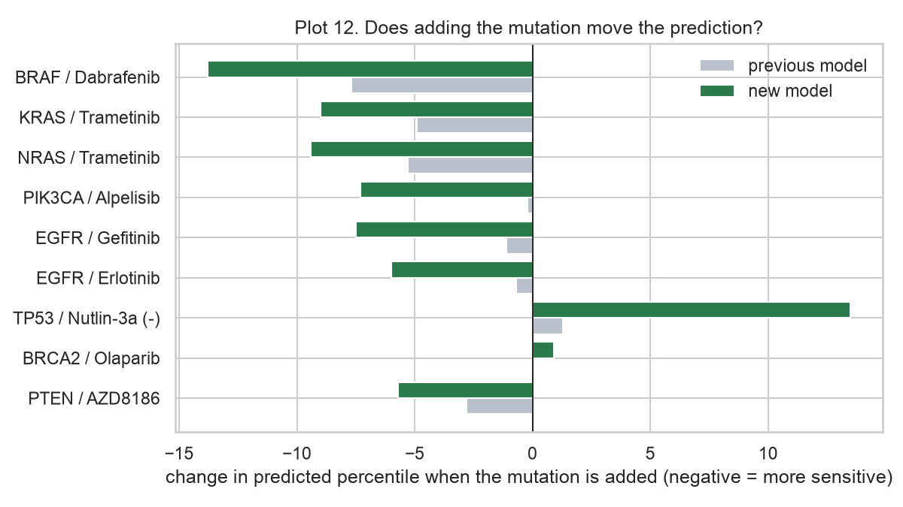

  

# Sentinel

**Which cancer drugs should a lab test first?**
AI + Health track · Veritas AI International High School Hackathon 2026

*This project is a prototype and is not medical advice. All data comes from cancer cell lines grown in a laboratory, not from patients.*

## What it does
Sentinel helps cancer researchers decide which drugs to test first on a new cell line. A researcher enters the cell line's tissue type and mutated genes, and Sentinel ranks the 286 screened drugs (295 drug IDs) by how likely the cell line is to respond, flags the drugs predicted to be sensitive and gives each drug a confidence level. It also shows how each prediction changes when a gene is added or removed. A stress test showed that our first model hardly used mutations, so we added a small model for each drug, which made it respond to mutations in the lab's direction for all 9 drug-gene pairs we checked.

This matters because a laboratory can usually afford to test only a few drugs on each new cell line. Testing the most promising drugs first means fewer wasted experiments and faster answers about which mutations make tumors respond to which drugs, knowledge that doctors later use to match treatments to a patient's tumor. Sentinel does not make treatment decisions and has not been tested on patient samples.

  

For SK-MEL-3, a melanoma cell line the model never saw, the top two drugs are the BRAF inhibitors PLX-4720 and Dabrafenib, and both were sensitive in the lab (shortlist from our first final model; the improved model gives the same two drugs at the top).

## Results
All results are on 192 cell lines held out from training (47,468 drug results). Knowing the drug alone already gives R² = 0.716, so we compare methods by **within-drug R²**: how much of the difference between cell lines on the same drug each method explains.

| Method | RMSE | Within-drug R² |
|---|---|---|
| Per-drug average | 1.464 | -0.007 |
| Per-drug + tissue average | 1.324 | 0.177 |
| Linear regression | 1.403 | 0.076 |
| First LightGBM | 1.339 | 0.159 |
| First final model (50/50 blend of the tissue average and a drug-centered LightGBM) | 1.302 | 0.204 |
| **Improved final model** (equal thirds: tissue average, drug-centered LightGBM, per-drug ridge regression) | **1.297** | **0.210** |

- **Shortlist:** 45.2% of the drugs in Sentinel's top 10 were truly sensitive, against 44.3% for the first final model, 41.6% for the per-drug + tissue average and 20.3% for random drugs. The gain over the first model is small and not re-checked on repeated splits.
- **Missed cases and false alarms:** flagging at the 30% level, the improved model finds 3,885 of 9,634 sensitive results (40.3%) and misses 5,749, with 2,598 false alarms (6.9%). At the strict 20% level it finds 2,233 (23.2%) with 1,051 false alarms (2.8%).
- **How solid the gain is:** the first final model beats the per-drug + tissue average on all 10 extra random splits, but only by 0.016 within-drug R² on average.
- **Where it fails:** solid tumors (first final model: within-drug R² 0.077 for lung against 0.554 for blood cancers), tissues with very few cell lines, and rare mutations such as EGFR.
- **Stress test and fix:** the first model hardly used mutations: adding TP53 moved Nutlin-3a by only 1.3 percentiles, although 53% of TP53-normal and 4% of TP53-mutant cell lines were sensitive in the lab. Adding a ridge regression for each drug made the model respond to mutations in the lab's direction for all 9 drug-gene pairs we checked: TP53 now moves Nutlin-3a by 13.5 percentiles and EGFR moves Gefitinib by 7.5. BRAF-normal melanoma lines are still steered towards Dabrafenib.

  

The notebook also checks results across sex and age groups and shows what the mutation features add.

## Repository layout
| Path | Contents |
|---|---|
| `Project_Code/Team_Sentinel_Health_AI.ipynb` | The whole project: data, baselines, final model, evaluation, drug shortlist and the Sentinel web app |
| `Project_Code/figures/` | Saved plots |
| `Project_Code/data/DATA_SOURCES.md` | Where the data comes from, usage terms and citations |

## How to run
Open the notebook in Google Colab (button above) and choose **Runtime → Run all**. Section 23 starts the Sentinel web app and prints a link to open it. The notebook downloads the public data from the Wellcome Sanger Institute automatically; no uploads or API keys are needed.

## Data and sources
GDSC2 drug-response data and Cell Model Passports annotations, Wellcome Sanger Institute. Raw data is not stored in this repository (see `Project_Code/data/DATA_SOURCES.md` for sources, licence and citations). Software, papers and AI tools used are listed in Section 25 of the notebook.
