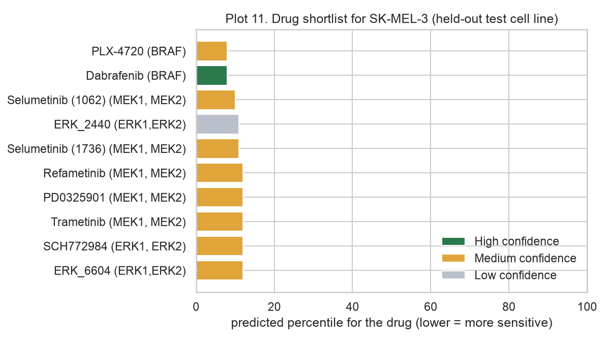

  

# Sentinel

**Which cancer drugs should a lab test first?**
AI + Health track · Veritas AI International High School Hackathon 2026

*This project is a prototype and is not medical advice. All data comes from cancer cell lines grown in a laboratory, not from patients.*

## What it does
Sentinel helps cancer researchers decide which drugs to test first on a new cell line. A researcher enters the cell line's tissue type and mutated genes (plus RNA-seq gene expression when evaluating a held-out cell line; user-entered profiles use the tissue average with a caution), and Sentinel ranks the 286 screened drugs (295 drug IDs) by how likely the cell line is to respond, flags the drugs predicted to be sensitive and gives each drug a confidence level. It also shows how each prediction changes when a gene is added or removed. After adding per-drug ridge models (Section 22) and two-stage RNA-seq gene expression features with tuned LightGBM and cross-validated per-drug blend weights (Sections 25–27), the model responds to mutations in the lab's direction for all 9 drug-gene pairs we checked and raises within-drug R² from `0.210` to `0.284`.

This matters because a laboratory can usually afford to test only a few drugs on each new cell line. Testing the most promising drugs first means fewer wasted experiments and faster answers about which mutations make tumors respond to which drugs, knowledge that doctors later use to match treatments to a patient's tumor. Sentinel does not make treatment decisions and has not been tested on patient samples.

  

For SK-MEL-3, a melanoma cell line the model never saw, the top two drugs are the BRAF inhibitors Dabrafenib and PLX-4720 (Plot 11 shows the first final model's shortlist; Section 27 ranks Dabrafenib #1 at the 4th percentile and PLX-4720 #2 at the 6th percentile, and both were sensitive in the lab).

## Results
All results are on 192 cell lines held out from training (47,468 drug results). Knowing the drug alone already gives R² = 0.716, so we compare methods by **within-drug R²**: how much of the difference between cell lines on the same drug each method explains.

| Method | RMSE | Within-drug R² |
|---|---|---|
| Per-drug average | 1.464 | -0.007 |
| Per-drug + tissue average | 1.324 | 0.177 |
| Linear regression | 1.403 | 0.076 |
| First LightGBM | 1.339 | 0.159 |
| First final model (50/50 blend of the tissue average and a drug-centered LightGBM) | 1.302 | 0.204 |
| Improved mutation model (Section 22: equal thirds with per-drug ridge) | 1.297 | 0.210 |
| **Final expression model** (Sections 25–27: 50 RNA-seq PCs, two-stage ridge, tuned LightGBM, CV blend weights) | **1.235** | **0.284** |

- **Shortlist & repeated splits:** **52.1%** of the drugs in Sentinel's top 10 were truly sensitive, against 45.2% for the Section 22 model, 44.3% for the first final model, 41.6% for the per-drug + tissue average and 20.3% for random drugs. Across 10 repeated splits (`random_state=0`), the final expression model beats both the per-drug + tissue average (`0.196`) and the Section 22 mutation model (`0.220`) on **all 10 of 10 splits**, averaging **0.298** within-drug R² (range 0.263 to 0.325) for an average gain of **0.102** over baseline (range 0.090 to 0.113) and **0.078** over Section 22 (range 0.070 to 0.093).
- **Gene expression and solid tumors:** adding the top 50 PCA components from the 1,500 most-variable genes (fitted on training lines only, using a two-stage ridge so expression does not drown out mutation effects) lifts overall test R² to 0.798 and more than doubles within-drug R² on **solid tumors** from **0.084** (Section 22) to **0.170** (measured against each drug's average within solid tumors). 933 of 958 cell lines have RNA-seq data (25 missing lines and new user-entered lines without expression use that tissue's training average plus a `has_expression` flag).
- **Missed cases and false alarms:** flagging at the 25% level (chosen by CV with <= 10% false alarms), the final expression model finds 3,833 of 9,634 sensitive results (39.8%) and misses 5,801, with 2,302 false alarms (6.1%, 62.5% precision). At the strict 20% level it finds 3,030 (31.5%) with 1,438 false alarms (3.8%, 67.8% precision). Only 37 of 192 test lines have no drug predicted sensitive (down from 71).
- **Where it fails & subgroup gaps:** rare mutations such as EGFR (only 21 mutant cell lines), extrapolation (71.8% of IC50 values lie above the highest tested dose), tissues with very few training lines, and residual tissue bias (`BRAF`-normal melanoma skin lines still rank Dabrafenib #2 at the 11th percentile vs #1 at the 4th percentile when `BRAF` is mutated). At the strict 20% cutoff, sensitive results are found more often for male (`34.2%`, 21 blood cancer test lines) than female (`26.3%`, 7 blood cancer lines) cell lines, and for donors under 18 (`50.2%`, 10 blood cancer lines) than over 65 (`7.5%`, 0 blood cancer lines); without blood cancers, recall drops to `5.0%` (Female), `6.2%` (Male), and `4.7%` to `7.5%` across known age groups (`8.3%` for Unknown), showing these gaps follow the share of blood cancers.
- **Stress test and fix:** the first model hardly used mutations: adding TP53 moved Nutlin-3a by only 1.3 percentiles, although 53% of TP53-normal and 4% of TP53-mutant cell lines were sensitive in the lab. Adding two-stage per-drug ridge regression and CV per-drug blend weights made the model respond in the lab's direction for all 9 drug-gene pairs we checked: TP53 now moves Nutlin-3a by 25.3 percentiles, BRAF moves Dabrafenib by -19.7, and EGFR moves Gefitinib by -15.3.

  

Across Sections 24–27 we compared **19 candidate settings** by 3-fold training cross-validation (`12` expression settings in Section 24, `3` two-stage `alpha_expr` values in Section 25, `3` new LightGBM settings against default in Section 26, and per-drug blend weights selecting among `3` ridge weights in Section 27). The notebook also logs our failed first expression attempt (Section 24, where `50 PCs, ridge+lgbm, alpha 30` reached CV R² `0.282` vs `0.209` but shrank `KRAS / Trametinib` from `-9.0` to `-3.3` percentiles and failed its check), checks results across sex and age groups, and measures what mutation and expression features add.

## Repository layout
| Path | Contents |
|---|---|
| `Project_Code/Team_Sentinel_Health_AI.ipynb` | The whole project: data, baselines, final model, evaluation, drug shortlist and the Sentinel web app |
| `Project_Code/figures/` | Saved plots |
| `Project_Code/data/DATA_SOURCES.md` | Where the data comes from, usage terms and citations |

## How to run
Open the notebook in Google Colab (button above) and choose **Runtime → Run all**. Section 29 starts the Sentinel web app and prints a link to open it. All outputs are already saved in the notebook, so it can be read without running it. A full run takes roughly 15–25 minutes in free Colab (including a 1.3 GB expression download); setting `RUN_STABILITY_CHECKS = False` in Section 1 skips the three repeated-split checks and saves about 40% of the time. The notebook downloads the public data from the Wellcome Sanger Institute automatically; no uploads or API keys are needed.

## Data and sources
GDSC2 drug-response data and Cell Model Passports annotations, mutations and RNA-seq expression, Wellcome Sanger Institute, used under the [Sanger DepMap Data Usage Policy](https://depmap.sanger.ac.uk/documentation/data-usage-policy/). Raw data is not stored in this repository (see `Project_Code/data/DATA_SOURCES.md` for files, licence and full citations).

Key references:
- Yang W, et al. Genomics of Drug Sensitivity in Cancer (GDSC). *Nucleic Acids Research* 41(D1):D955–D961, 2013. https://doi.org/10.1093/nar/gks1111
- Iorio F, et al. A Landscape of Pharmacogenomic Interactions in Cancer. *Cell* 166(3):740–754, 2016. https://doi.org/10.1016/j.cell.2016.06.017
- van der Meer D, et al. Cell Model Passports. *Nucleic Acids Research* 47(D1):D923–D929, 2019. https://doi.org/10.1093/nar/gky872
- Ghandi M, et al. Next-generation characterization of the Cancer Cell Line Encyclopedia. *Nature* 569:503–508, 2019. https://doi.org/10.1038/s41586-019-1186-3
- Ke G, et al. LightGBM: A Highly Efficient Gradient Boosting Decision Tree. *NeurIPS* 30, 2017. [Link](https://proceedings.neurips.cc/paper/2017/hash/6449f44a102fde848669bdd9eb6b76fa-Abstract.html)
- Pedregosa F, et al. Scikit-learn: Machine Learning in Python. *JMLR* 12:2825–2830, 2011. [Link](https://jmlr.org/papers/v12/pedregosa11a.html)

The full list (methods, the biology behind the drug–gene checks, software and tools) is in the last section of the notebook.
